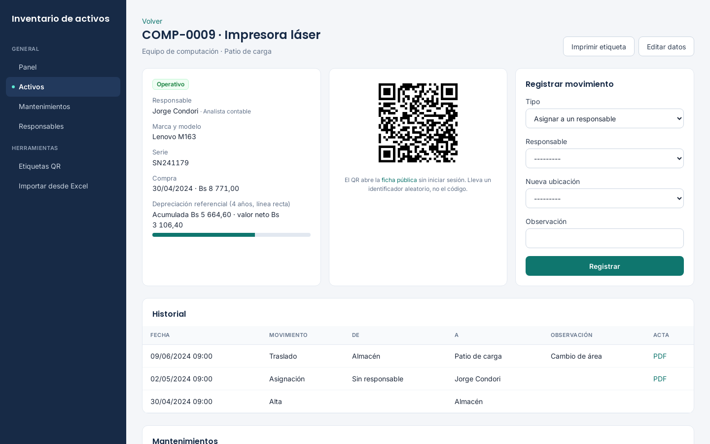
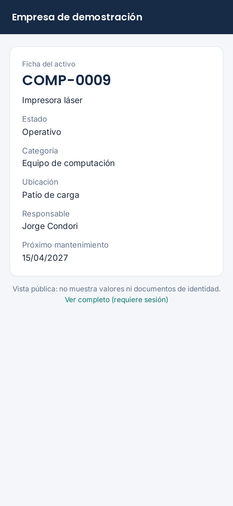
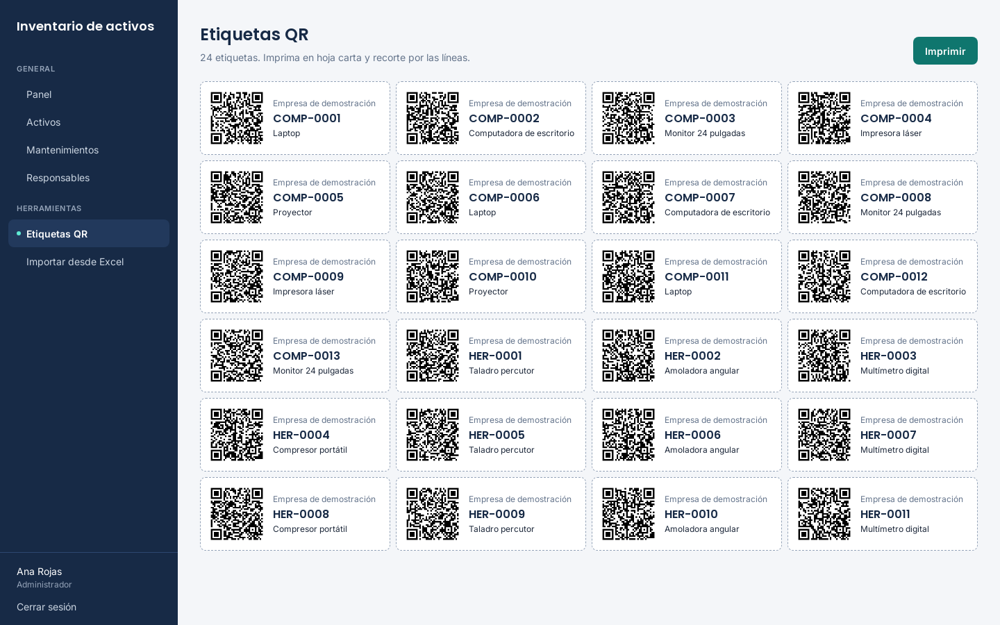
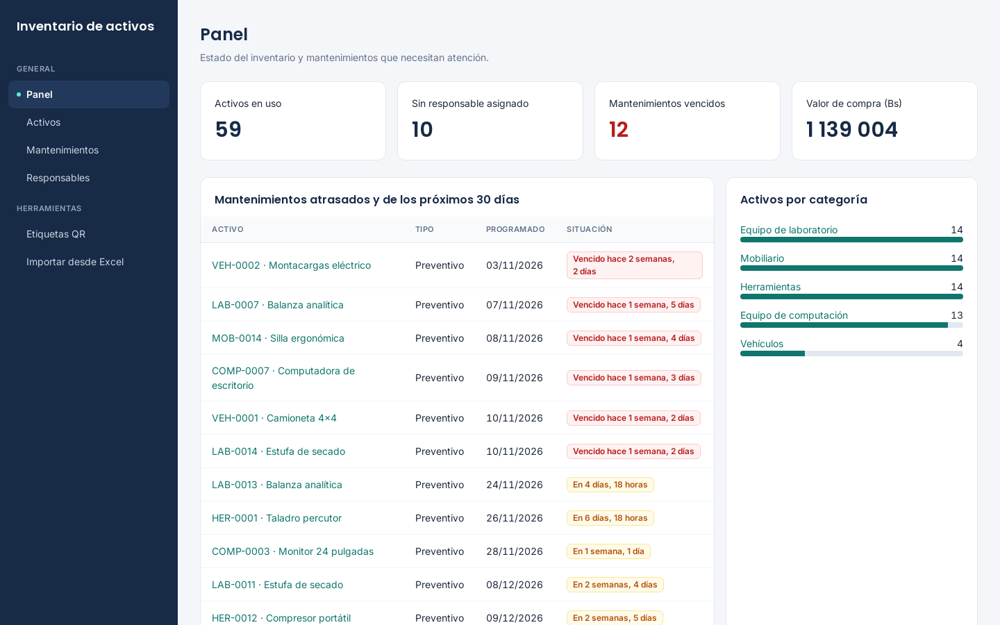
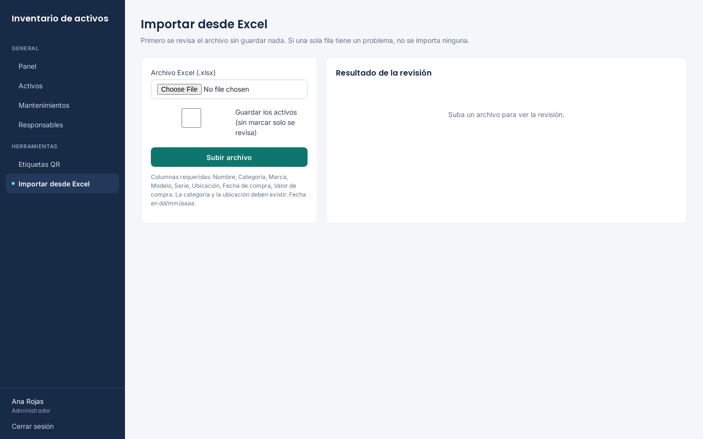

# Inventario de activos con QR

Sistema web para controlar los activos fijos de una empresa: quién tiene cada equipo, dónde está, cuándo le toca mantenimiento y cuánto vale hoy. Cada activo lleva una etiqueta QR que abre su ficha desde el celular.

Versión base de demostración. Todos los datos son ficticios.



## Qué hace

- **Activos con código automático** por categoría (`COMP-0001`, `HER-0012`) y ficha con marca, serie, ubicación, responsable y estado.
- **Movimientos con historial:** asignación, devolución, traslado y baja. Un activo dado de baja no admite más movimientos. Cada movimiento genera su **acta en PDF**.
- **Etiquetas QR imprimibles.** El QR lleva un identificador aleatorio, no el código, y abre una **ficha pública** que no muestra valores ni documentos de identidad.
- **Mantenimientos** preventivos y correctivos. Al registrar un preventivo se programa el siguiente según la categoría; el panel muestra los vencidos y los de los próximos 30 días.
- **Depreciación referencial** en línea recta según la vida útil de la categoría.
- **Excel:** descarga del inventario filtrado e importación con revisión previa. Si una sola fila tiene un problema (categoría desconocida, serie repetida, fecha inválida) no se importa nada. Hay un [archivo de ejemplo](docs/ejemplo-importacion.xlsx).
- **Roles:** Administrador, Técnico (registra y mueve) y Consulta (solo lectura).

| Ficha pública desde el QR | Etiquetas para imprimir |
|---|---|
|  |  |

| Panel | Importación desde Excel |
|---|---|
|  |  |

## Tecnología

Django 5.2 · Python 3.12 · MariaDB 11 · plantillas de Django con CSS propio (sin framework) · qrcode · ReportLab · openpyxl · Gunicorn + WhiteNoise · Docker

## Probarlo

Requiere Docker.

```bash
git clone https://github.com/Xarod65211/inventario-activos.git
cd inventario-activos
docker compose up -d --build
```

Abra http://localhost:8540. La primera vez carga 60 activos, sus movimientos y mantenimientos.

| Usuario | Rol | Contraseña |
|---|---|---|
| admin | Administrador | demo1234 |
| tecnico | Técnico | demo1234 |
| consulta | Consulta | demo1234 |

Para que el QR funcione desde un celular en la misma red, cambie `URL_PUBLICA` en `docker-compose.yml` por la IP de su equipo y reimprima las etiquetas.

## Pruebas

```bash
pip install -r requirements.txt
python manage.py test inventario
```

Sin `DB_HOST` usa SQLite. Las pruebas cubren el código y el token del QR, asignación, traslado y devolución con historial, bloqueo de activos dados de baja, depreciación, ficha pública sin datos sensibles, QR y acta PDF, permisos por rol, mantenimiento que programa el siguiente, exportación y la importación que no guarda nada si hay errores.

## Dónde está cada cosa

| Ruta | Contenido |
|---|---|
| `inventario/models.py` | Activos, movimientos, mantenimientos y depreciación |
| `inventario/servicios.py` | Reglas de cada tipo de movimiento |
| `inventario/documentos.py` | QR, acta PDF y libro Excel |
| `inventario/importacion.py` | Revisión e importación desde Excel |
| `inventario/management/commands/datos_demo.py` | Datos de demostración |
| `static/css/app.css` | Estilos (ver `DESIGN.md`) |

## Autor

Aramis Corini · [Portafolio](https://xarod65211.github.io)

Licencia MIT. Las fuentes Inter y Poppins se distribuyen bajo la SIL Open Font License (ver `static/fuentes`).
